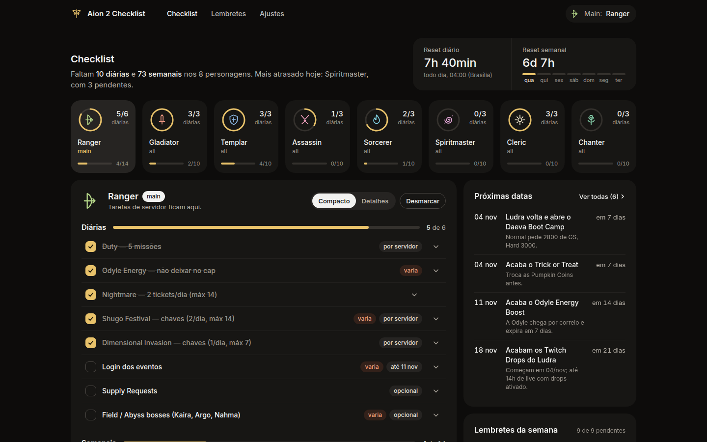
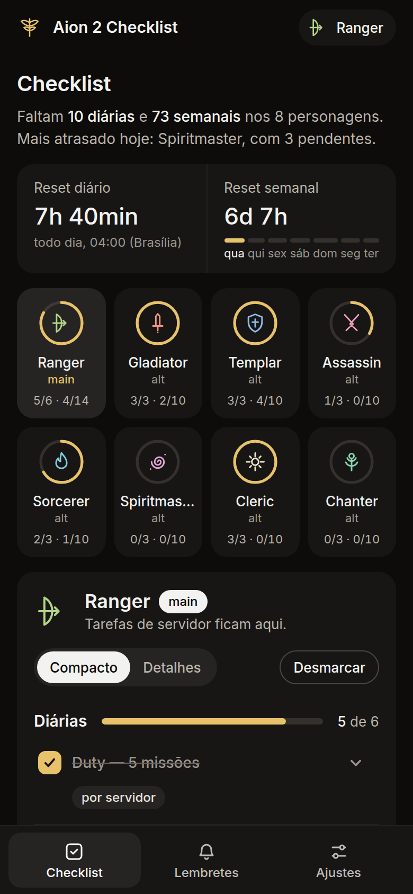
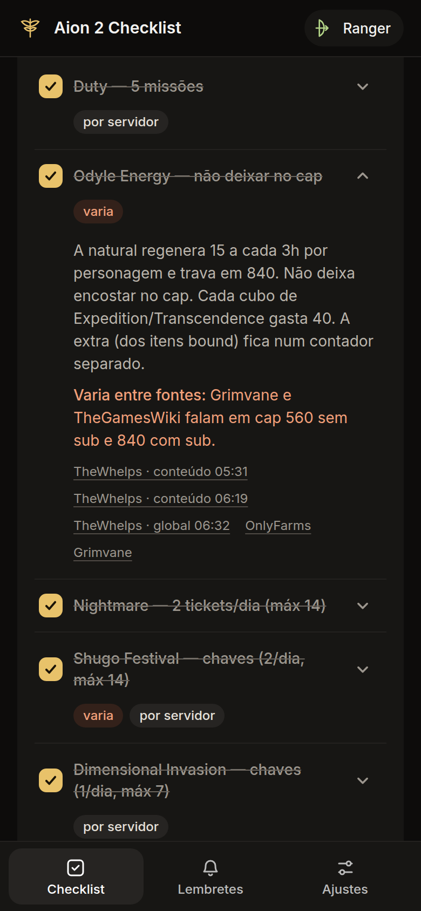
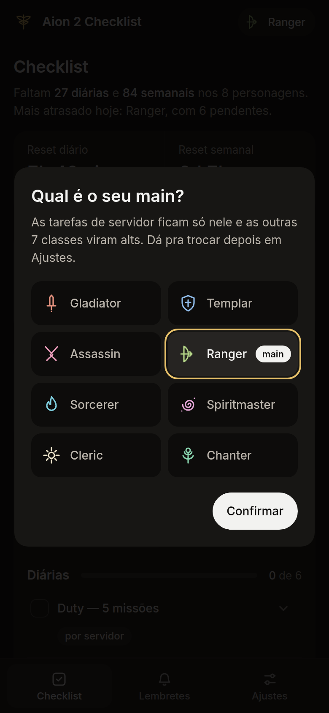
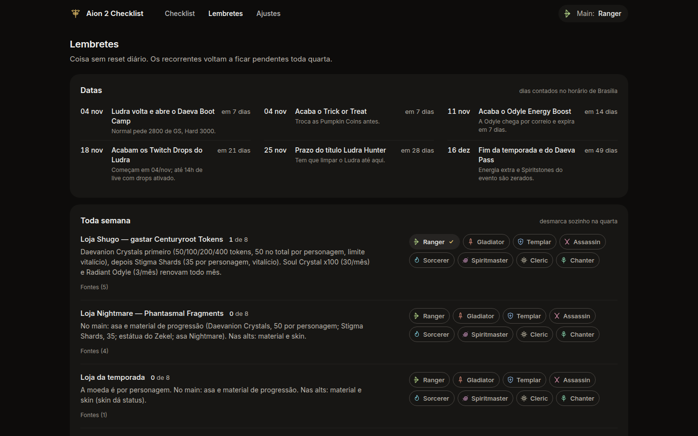

# Aion 2 Checklist

Checklist de diárias e semanais do **Aion 2 global** pra quem joga com main + alts. Você marca o que já fez em cada personagem e a página zera sozinha no reset (04:00 de Brasília).

**Acesse:** https://rodrigoos098.github.io/aion2-checklist/



## O que tem

- **Escolha do main na primeira visita.** Fica salvo no seu navegador, então cada um que abrir o link escolhe o próprio main.
- **8 personagens**, um de cada classe: Gladiator, Templar, Assassin, Ranger, Sorcerer, Spiritmaster, Cleric e Chanter. O main e mais 7 alts.
- **Checklist por personagem.** O que é por servidor (Duty, chaves de Shugo e Invasion, Daily Dungeon, Command Scrolls) só aparece no main. As alts ficam só com o que é por personagem.
- **Reset automático com contagem regressiva.** Diário às 04:00 de Brasília (07:00 UTC) e semanal na quarta às 04:00.
- **Visão geral** de todos os personagens: anel com as diárias e barra com as semanais de cada um, e quanto falta no total.
- **Lembretes** do que não tem reset fixo: gastar chave de Shugo, lojas com limite vitalício ou mensal (Shugo, Nightmare, temporada), Hidden Cubes, Kinah das alts pro main e as datas de evento que estão chegando.
- **Apelidos**, esconder personagem que você não joga, **exportar/importar** o progresso em JSON e **zerar na mão** se precisar.
- Tudo fica no **localStorage** do navegador. Não tem conta, login nem servidor.

<p>
  
  
  
</p>



## Rodar local

É HTML, CSS e JS puro, sem build. Abre o `index.html` direto no navegador ou sobe um servidor qualquer:

```bash
python3 -m http.server 8000
```

## Atualizar os dados

- As tarefas ficam em `data.js`, gerado a partir de `pesquisa/checklist.json` pelo `tools/build_data.py`.
- Pra mudar texto, número ou adicionar item, edita o `TEXTOS` (e o `CORR`, se for correção de dado) no `tools/build_data.py` e roda:

```bash
python3 tools/build_data.py
```

- Cada item tem `frequency` (`daily`, `weekly`, `recurring` ou `one-off`), `appliesTo` (`main`, `alt` ou `both`) e `scope` (`server`, `character` ou `account`). Item com `scope: "server"` só aparece no main. Item com `expires` some depois da data.
- As datas de evento e o horário de PvP ficam no mesmo script, em `events` e `schedule`.
- Dá pra editar o `data.js` na mão também, mas aí a mudança some na próxima vez que alguém rodar o script.

## Fontes

- Vídeos do canal [TheWhelps](https://www.youtube.com/@whelps) no YouTube: conteúdo diário e semanal, guia de alts, Duty, patch de 21/10 e os guias por faixa de GS. Cada item linka o trecho do vídeo.
- Guias da comunidade: [OnlyFarms](https://onlyfarms.gg/guides/aion-2-daily-weekly-checklist/), [aion2.vi.ki](https://aion2.vi.ki/endgame-routine), [Grimvane](https://aion2.grimvane.app/abyss-boss-timers/), [odyle.net](https://odyle.net/en/cuaderno/tienda-shugo-festival/), [Wikily](https://wikily.gg/aion-2/shops/festival-shop) e [TheGamesWiki](https://thegameswiki.com/aion-2/wiki/global-material-farming-planner).
- A pesquisa completa está em `pesquisa/checklist.md`.

Os números podem mudar entre fontes e entre o KR e o global. Quando as fontes não batem, o item aparece com a tag **varia** e a explicação fica nos detalhes. Achou algo errado? Abre uma issue.

---

Projeto de fã, não oficial e sem vínculo com a NCSOFT. Aion é marca da NCSOFT.
